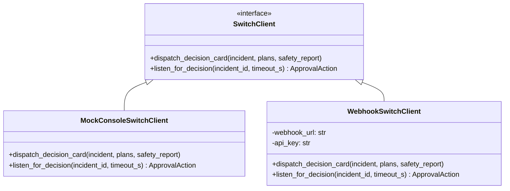
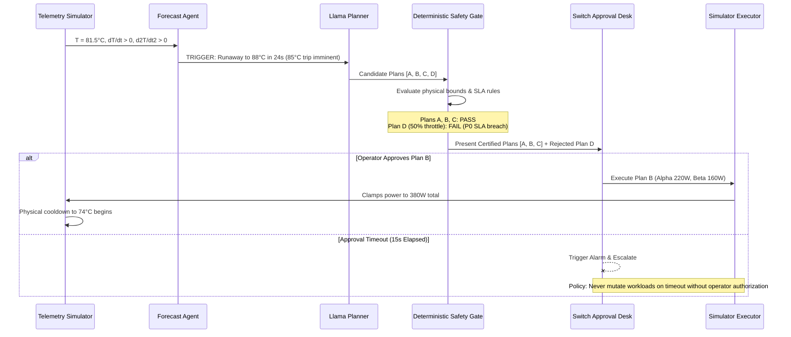

# ThermoPilot Compute Desk: System Architecture

> Architectural specifications, component designs, safety boundaries, and interface contracts for the ThermoPilot multi-agent GPU thermal management system.

---

## 1. System Overview

ThermoPilot Compute Desk bridges physical GPU infrastructure constraints with high-level business and SLA commitments. Unlike traditional hardware controllers that blindly throttle frequencies or evict arbitrary jobs, ThermoPilot operates as an autonomous cognitive layer that deliberates, plans, validates, and presents trade-offs to human operators.

```mermaid
flowchart TD
    subgraph Infrastructure ["1. Simulated Infrastructure Layer"]
        SIM["Telemetry Simulator\n(GPU Temp, Power, Fan, Clocks, Time Scaling)"]
    end

    subgraph Perception ["2. Perception & Risk Forecast"]
        FA["Thermal Forecast Agent\n(Trend Extrapolation, t_TTT to 85°C Hardware Trip)"]
    end

    subgraph Agents ["3. Multi-Agent Workload Profiles"]
        WA1["Workload Agent Alpha\n(P0 SLA-Critical Batch / Inference)"]
        WA2["Workload Agent Beta\n(P2 Flexible / Checkpointable Training)"]
    end

    subgraph Reasoning ["4. Strategic Planning"]
        LP["Llama Recovery Planner\n(Proposes Plans A, B, C and evaluates D)"]
    end

    subgraph Guardrail ["5. Deterministic Safety"]
        SG["Deterministic Safety Gate\n(Enforces ≤80°C, Power Cap, P0 SLA, Min Floor)"]
    end

    subgraph HumanLoop ["6. Human-in-the-Loop"]
        SW["Switch Decision Desk\n(Interactive Card: Plans A, B, C; Shows D Rejected)"]
    end

    subgraph Execution ["7. Execution & Verification"]
        EX["Simulator Executor\n(Applies Approved Power Caps, Pauses, Migrations)"]
        VA["Verification Agent\n(Validates Cooldown ≤75°C & SLA Adherence)"]
        AUD["Immutable Audit Ledger\n(Append-Only JSONL Event Store)"]
    end

    SIM -->|Raw Telemetry Stream (1Hz)| FA
    FA -->|Thermal Alert at 81.5°C & Horizon| LP
    FA -.->|Thermal Alert| WA1
    FA -.->|Thermal Alert| WA2
    WA1 -->|Bids, Deadlines & SLA Penalties| LP
    WA2 -->|Flexibility, Checkpoint State| LP
    LP -->|Candidate Recovery Plans A, B, C, D| SG
    SG -->|Certified Feasible Plans A, B, C| SW
    SG -.->|Reject Plan D: SLA Breach / Min Power Floor| SW
    SW -->|Human Approved Action| EX
    SW -.->|Timeout Escalation: Alarm Only, No Workload Mutation| AUD
    EX -->|State Update| SIM
    EX -->|Post-Action Telemetry| VA
    VA -->|Verification Report| AUD
    SW -->|Decision Event| AUD
    LP -->|Planning Rationale| AUD
```

---

## 2. Component Specifications

### 2.1 Telemetry Simulator (`thermopilot.simulator.telemetry`)
- **Responsibility:** Simulates continuous hardware metrics across a dual-GPU node or cluster zone.
- **Physical Model:**
  $$\Delta T_{t} = \left( \frac{P_t \cdot R_{th} - (T_t - T_{amb})}{\tau_{thermal}} \right) \Delta t + \epsilon_{ambient}$$
  - $P_t$: Power consumption (Watts), function of active workloads and frequency caps.
  - $R_{th}$: Thermal resistance ($0.14^\circ\text{C}/\text{W}$).
  - $\tau_{thermal}$: Thermal time constant ($15.0\text{s}$).
  - $T_{amb}$: Ambient data center intake temperature ($22.0^\circ\text{C}$ baseline; cooling anomaly injects $32.0^\circ\text{C}$).
- **Time Scaling:** Supports a configurable simulation speed factor ($\text{time\_scale} = 2.5\times$ in live demo mode). This allows 7 seconds of wall-clock presentation to correspond to $\approx 17.5$ seconds of simulated cluster thermal dissipation, matching real physical decay curves without stalling stage demonstrations.
- **Output:** Emits structured `GPUTelemetry` records at 1 Hz.

### 2.2 Thermal Forecast Agent (`thermopilot.agents.forecast`)
- **Responsibility:** Anticipates thermal incidents before the hardware trip threshold ($85.0^\circ\text{C}$) is reached.
- **Mechanism:**
  - Evaluates rolling telemetry windows for first-order derivative ($\frac{dT}{dt}$) and second-order acceleration ($\frac{d^2T}{dt^2}$).
  - Computes **Time-to-Throttle ($t_{TTT}$)**: projected seconds until $T \ge 85.0^\circ\text{C}$.
  - Dispatches incident triggers when $T \ge 81.5^\circ\text{C}$ with positive thermal acceleration ($\frac{d^2T}{dt^2} > 0$) and $t_{TTT} \le 30\text{s}$.

### 2.3 Competing Workload-Owner Agents (`thermopilot.agents.workloads`)
- **Agent Alpha (SLA-Critical Inference / VIP Batch):**
  - **Profile:** P0 priority, low latency tolerance, \$500/hr SLA penalty (\$5.50/s late fee).
  - **Constraints:** `can_preempt = False`, minimum power floor $200\text{W}$.
  - **Strategy:** Protects allocated power; accepts modest power reduction down to $220\text{W}$ if deadline is safely preserved.
- **Agent Beta (Exploratory / Checkpointable Training):**
  - **Profile:** P2 priority, elastic deadline, checkpoint available, \$20/hr SLA penalty.
  - **Constraints:** `can_preempt = True`, `can_power_cap = True`.
  - **Strategy:** Tolerates power capping (down to 160W), checkpoint-pause, or migration to secondary/cloud capacity in exchange for cluster credits.

### 2.4 Llama-Powered Recovery Planner (`thermopilot.planner.llama`)
- **Responsibility:** Synthesizes workload bids, current telemetry, and cluster topology to generate three certified feasible recovery options alongside evaluating common naive practices:
  1. *Plan A (Conservative Shed — Feasible):* Checkpoint-pause Beta; allocate safe power to Alpha ($220\text{W}$). Guarantees fast cooldown ($\Delta T = -14^\circ\text{C}$) with zero VIP SLA risk.
  2. *Plan B (Balanced Dynamic Cap — Feasible & Recommended):* Dynamically adjusts power caps (Alpha 220W, Beta 160W; total 380W $\le 400\text{W}$ budget). Both jobs run, zero SLA breach on Alpha, minimal delay on Beta, optimal net economics (\$12).
  3. *Plan C (Workload Migration / Offload — Feasible):* Export Beta checkpoint and migrate active steps to secondary/cloud node. Alpha retains full 250W power envelope. Small cloud transfer cost (\$28).
  4. *Plan D (Blind 50% Throttle — Unsafe Candidate):* Slashes power equally across both jobs (125W each). Evaluated by the Safety Gate and explicitly rejected due to P0 SLA contract breach and violation of minimum power floor.
- **Resilience Fallback:** A local deterministic cache generates pre-computed valid schemas instantly if LLM response latency exceeds 2.5 seconds.

### 2.5 Deterministic Safety Gate (`thermopilot.safety.gate`)
- **Responsibility:** Non-bypassable deterministic Python validator acting between the LLM planner and human presentation.
- **Deterministic Rules Enforced:**
  1. `RULE_TEMP_CEILING`: Projected steady-state temperature $T_{ss} \le 80.0^\circ\text{C}$.
  2. `RULE_NODE_POWER_BUDGET`: Total allocated power $\sum P_i \le 400.0\text{W}$.
  3. `RULE_NO_P0_PREEMPTION`: Workloads marked `can_preempt = False` cannot be terminated or paused.
  4. `RULE_P0_SLA_PRESERVATION`: No plan may induce an expected SLA penalty on P0 workloads.
  5. `RULE_MIN_POWER_FLOOR`: Power cap cannot be set below `min_power_w` ($200\text{W}$ for Alpha).
- **Result:** Plans A, B, and C pass all rules. Plan D violates Rules 4 & 5 and is marked `REJECTED`. Unsafe plans are displayed with clear rejection reasons; they cannot be approved.

### 2.6 Switch Human-in-the-Loop Approval Desk (`thermopilot.hitl.switch`)
- **Responsibility:** Presents validated plans to on-call operators and captures explicit authorization.
- **Decision Card Elements:**
  - Incident severity banner and $t_{TTT}$ countdown to $85^\circ\text{C}$ hardware trip.
  - Side-by-side comparison of certified options:
    - Plan A (Conservative Shed: $-\$45$, $\Delta T = -14^\circ\text{C}$)
    - Plan B (Balanced Cap: $-\$12$, $\Delta T = -9^\circ\text{C}$ — Recommended)
    - Plan C (Migration: $-\$28$, $\Delta T = -12^\circ\text{C}$)
  - Plan D displayed in struck-through/red state as `REJECTED BY SAFETY GATE (P0 SLA Violation)`.
  - Operator actions: `[Approve Plan A]`, `[Approve Plan B]`, `[Approve Plan C]`, `[Reject / Escalate]`.
- **Approval Timeout Policy:**
  - **Strict Principle:** An approval timeout **never automatically executes a workload-changing action**.
  - If the operator does not respond within the 15-second window, the system registers `TIMEOUT_ESCALATED`, triggers audible/visual alarm escalation, and leaves workloads in their current state rather than making unauthorized workload alterations.

### 2.7 Simulator Executor & Verification Agent (`thermopilot.executor`)
- **Simulator Executor:** Ingests the human-selected plan and reconfigures the simulator (power caps, job pause, migration state).
- **Verification Agent:** Monitors post-execution telemetry over 30 ticks to verify:
  1. Temperature decays toward safe target $T_{safe\_target} \le 75.0^\circ\text{C}$ at $\ge 0.5^\circ\text{C}/\text{s}$ simulated rate.
  2. Alpha finishes within its deadline with 0 SLA violations.
  3. No secondary thermal oscillations occur.

### 2.8 Audit Ledger (`thermopilot.audit.ledger`)
- Emits append-only JSONL records containing:
  - Telemetry snapshot at incident trigger
  - Forecast trajectory and confidence
  - Workload bids and constraints
  - Planner candidate output and Safety Gate evaluation
  - Operator ID, decision timestamp, and approved plan ID
  - Post-execution verification findings

---

## 3. Data Contracts & Interfaces

All data structures inherit from Pydantic `BaseModel`:

### 3.1 Telemetry Contract (`GPUTelemetry`)
```json
{
  "timestamp": "2026-10-27T10:00:00.000Z",
  "gpu_id": 0,
  "temperature_core_c": 81.5,
  "temperature_junction_c": 89.2,
  "power_draw_w": 380.0,
  "power_limit_w": 400.0,
  "fan_speed_pct": 92.0,
  "clock_freq_mhz": 1845,
  "utilization_pct": 98.0,
  "ambient_temp_c": 32.0
}
```

### 3.2 Workload Profile (`WorkloadSpec`)
```json
{
  "workload_id": "wl-alpha-inference",
  "name": "Financial Trading Batch",
  "owner": "Trading-Prod",
  "priority": "P0_CRITICAL",
  "current_power_w": 250.0,
  "min_power_w": 200.0,
  "max_power_w": 250.0,
  "can_preempt": false,
  "can_power_cap": true,
  "sla_deadline_s": 90.0,
  "sla_penalty_usd_per_s": 5.50
}
```

### 3.3 Recovery Plan Option (`RecoveryPlanOption`)
```json
{
  "plan_id": "PLAN-B",
  "name": "Dynamic Workload Power-Cap Balancing",
  "strategy_type": "BALANCED_POWER_CAP",
  "is_recommended": true,
  "projected_temp_max_c": 74.0,
  "cooling_time_to_safe_s": 17.5,
  "workload_actions": [
    {
      "workload_id": "wl-alpha-inference",
      "action": "POWER_CAP",
      "target_power_w": 220.0
    },
    {
      "workload_id": "wl-beta-training",
      "action": "POWER_CAP",
      "target_power_w": 160.0
    }
  ],
  "estimated_cost_usd": 12.00,
  "sla_violations_expected": 0,
  "rationale": "Balances thermal reduction across both jobs; preserves Alpha P0 deadline while keeping total node power under 380W."
}
```

### 3.4 Safety Gate Evaluation (`SafetyGateResult`)
```json
{
  "plan_id": "PLAN-B",
  "passed": true,
  "evaluations": [
    {"rule_name": "RULE_TEMP_CEILING", "passed": true, "detail": "Steady state 74.0C <= 80.0C", "observed_value": 74.0, "limit_value": 80.0},
    {"rule_name": "RULE_NODE_POWER_BUDGET", "passed": true, "detail": "380.0W <= 400.0W", "observed_value": 380.0, "limit_value": 400.0},
    {"rule_name": "RULE_NO_P0_PREEMPTION", "passed": true, "detail": "Alpha not preempted", "observed_value": "ACTIVE", "limit_value": "NO_PREEMPTION"},
    {"rule_name": "RULE_P0_SLA_PRESERVATION", "passed": true, "detail": "Expected P0 SLA violations: 0", "observed_value": 0, "limit_value": 0},
    {"rule_name": "RULE_MIN_POWER_FLOOR", "passed": true, "detail": "Alpha power 220W >= 200W floor", "observed_value": 220.0, "limit_value": 200.0}
  ],
  "rejection_reasons": []
}
```

### 3.5 Human Approval Action (`ApprovalAction`)
```json
{
  "incident_id": "INC-20261027-001",
  "selected_plan_id": "PLAN-B",
  "operator_id": "operator-oncall",
  "decision": "APPROVE",
  "timestamp": "2026-10-27T10:00:15.120Z",
  "notes": "Approved recommended balanced plan to safeguard financial trading SLA."
}
```

---

## 4. Switch Integration Architecture & Unknowns

The Switch integration connects ThermoPilot to human governance. Because no external Switch SDK or endpoint specifications are currently present in the codebase, the system implements an explicit interface contract:



### Specific Unknowns Requiring Future Verification:
1. **API Endpoint & Protocol:** Official HTTP/WebSocket endpoint URLs and authentication credentials.
2. **Payload Specification:** The exact JSON schema required by the Switch frontend to render multi-option decision tables with clickable action buttons.
3. **Callback Path:** Whether Switch sends HTTP webhooks to an endpoint exposed by ThermoPilot (requiring a tunnel) or whether ThermoPilot polls an incident resolution API.

---

## 5. Fail-Safe Execution Flow


