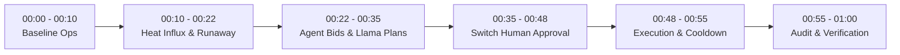
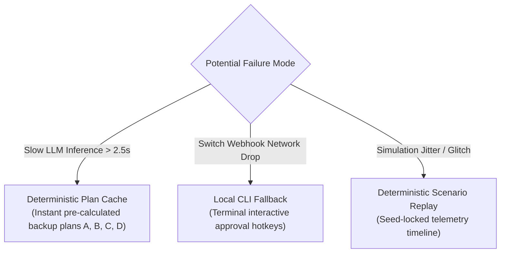

# ThermoPilot Compute Desk: 60-Second Demonstration & Evaluation Plan

> **Flip the Switch Hackathon 2026** — Demonstration script, timeline, evaluation rubric, and resilience fallbacks.

---

## 1. Demonstration Philosophy

A successful hackathon demo must convey high business value, tangible multi-agent intelligence, and rock-solid deterministic safety within **60 seconds**.

Judges must see:
1. An active GPU cluster encountering a realistic thermal emergency.
2. Two competing business workloads bidding for thermal and power resources.
3. An LLM planner generating three feasible trade-off recovery plans and evaluating a naive candidate.
4. A deterministic safety gate rejecting the unsafe candidate and certifying valid options.
5. An intuitive **Switch** decision card allowing the human operator to make a one-click business decision.
6. Execution and verified physical cooldown with zero VIP SLA breach.

---

## 2. Second-by-Second 60-Second Demonstration Flow

### [00:00 - 00:10] Act I: Normal High-Density Cluster Operations
- **Visual:** Compute Desk live console shows GPU 0 operating at normal steady state:
  - Core Temp: $71.2^\circ\text{C}$ (Normal Green). Total Power: 380W. Fan: 70%.
  - **Workload Alpha:** Mission-critical financial transaction batch (P0, SLA deadline in 90s, \$500/hr penalty if delayed, non-preemptible).
  - **Workload Beta:** Exploratory diffusion model fine-tuning (P2, elastic deadline, checkpointable).
- **Narrator:** *"Here is ThermoPilot Compute Desk monitoring our GPU node. We have two competing workloads running under dense cluster utilization."*

### [00:10 - 00:22] Act II: Thermal Influx & Predictive Alarm
- **Visual:** Ambient intake heat spike is injected ($22^\circ\text{C} \to 32^\circ\text{C}$). Core temp climbs steadily: $74^\circ\text{C} \rightarrow 78^\circ\text{C} \rightarrow 81.5^\circ\text{C}$ with positive acceleration $\frac{d^2T}{dt^2} > 0$.
- **Forecast Agent Alert:** Console displays high-visibility alert:
  - `CRITICAL THERMAL ALERT: Projected Runaway to 88°C in 24 seconds (Exceeds 85°C Hardware Trip)`.
- **Narrator:** *"A cooling anomaly hits the rack. Instead of waiting for blind hardware throttling at 85°C, our Forecast Agent intercepts the curve at 81.5°C, 24 seconds ahead of disaster."*

### [00:22 - 00:35] Act III: Workload Bidding, Llama 3 Planning & Safety Gate Certification
- **Visual:** Workload agents negotiate:
  - Agent Alpha demands power protection: *'P0 Priority. Latency sensitive. Cannot preempt; requires min 200W.'*
  - Agent Beta counters: *'P2 Priority. Can checkpoint-pause, migrate, or cap down to 160W for cluster credits.'*
- **Llama Recovery Planner:** Synthesizes the constraints into 4 candidate plans:
  - **Plan A (Conservative Shed — Feasible):** Pause Beta, preserve Alpha at 220W. $\Delta T = -14^\circ\text{C}$, Net Cost = \$45.
  - **Plan B (Balanced Dynamic Cap — Feasible, Recommended):** Dynamic power caps (Alpha 220W, Beta 160W; total 380W). $\Delta T = -9^\circ\text{C}$, Net Cost = \$12, Zero SLA breach.
  - **Plan C (Workload Migration — Feasible):** Migrate Beta compute chunk to secondary node. $\Delta T = -12^\circ\text{C}$, Net Cost = \$28.
  - **Plan D (Blind 50% Throttle — Unsafe Candidate):** Cuts Alpha & Beta to 125W. $\Delta T = -16^\circ\text{C}$, Net Cost = \$320 (Causes catastrophic P0 SLA penalty).
- **Deterministic Safety Gate:** Evaluates all four:
  - Plan A: `PASS`
  - Plan B: `PASS`
  - Plan C: `PASS`
  - Plan D: `REJECTED — Violates P0 SLA Preservation & Falls Below 200W Min Power Floor`.
- **Narrator:** *"Llama formulates candidate options, and our Deterministic Safety Gate immediately blocks Plan D because it would cause a $320 SLA penalty. Only certified safe plans reach the operator."*

### [00:35 - 00:48] Act IV: Switch Human-in-the-Loop Sign-Off
- **Visual:** The incident appears directly on **Switch** (with local CLI fallback active) showing the trade-off table of certified options and Plan D struck-through in red.
- **Action:** Operator reviews trade-offs and clicks **[Approve Plan B: Balanced Dynamic Cap]**.
- **Timeout Policy Highlight:** If unattended, the system sounds an escalation alarm; it **never mutates workloads automatically** without explicit operator authorization.
- **Narrator:** *"Switch puts the operator in control. With one click, the operator approves Plan B, balancing physical cooling with customer SLAs."*

### [00:48 - 00:55] Act V: Execution & Verified Thermal Decay
- **Visual:** Power limits clamp to 220W (Alpha) and 160W (Beta). Total node power clamps to 380W.
- **Time Scaling in Demo:** 7 wall-clock seconds represent $\approx 17.5$ seconds of accelerated simulation time ($\text{time\_scale} = 2.5\times$).
- **Thermal Decay:** Core temp curves downward smoothly: $81.5^\circ\text{C} \rightarrow 77.0^\circ\text{C} \rightarrow 74.0^\circ\text{C}$ (safely below the $75.0^\circ\text{C}$ safe target).
- **Workload Progress:** Alpha completes successfully on time with zero SLA penalty. Beta continues training at modest throughput reduction.
- **Narrator:** *"The simulator executes the power caps. The GPU cools to 74°C in 17 simulated seconds, and our VIP financial batch finishes without a penalty."*

### [00:55 - 01:00] Act VI: Verification & Immutable Audit Trail
- **Visual:** Verification Agent outputs:
  - `VERIFIED: Thermal envelope restored (74.0°C <= 75.0°C target). SLA compliance: 100%. P0 violations: 0.`
- **Audit Ledger:** Displays the cryptographic JSONL audit record with operator ID, chosen plan, safety gate evaluation, and verified savings summary (\$488 saved vs. hardware shutdown).
- **Narrator:** *"ThermoPilot turned a hardware thermal crisis into an auditable, human-approved business win."*

---

## 3. Evaluation Metrics

| Category | Metric | Target | Description |
| :--- | :--- | :--- | :--- |
| **1. Thermal Safety** | Hardware Trip Violations ($>85.0^\circ\text{C}$) | **0 occurrences** | Critical hardware trip threshold never reached. |
| | Target Safe Recovery ($T \le 75.0^\circ\text{C}$) | **$< 25$ simulated seconds** | Duration from operator approval to reaching safe equilibrium. |
| **2. Business & SLA** | P0 SLA Violations | **0%** | Mission-critical jobs always complete within deadline. |
| | Financial Impact Avoidance | **$> 80\%$ savings** | Avoided downtime and penalties compared to baseline blind throttle. |
| **3. Human Governance** | Decision Latency | **$< 15$ seconds** | Clear card layout enables immediate operator comprehension. |
| | Timeout Safety Guarantee | **0 unauthorized changes** | System alarms and escalates on timeout without muting or killing jobs. |
| **4. Architectural Integrity** | Safety Gate Rejection Accuracy | **100% rejection** | Deterministic gate prevents unsafe Plan D from reaching execution. |
| | Post-Execution Verification Match | **$\ge 95\%$ agreement** | Realized temperature decay matches planner's projected decay. |

---

## 4. Failure Modes & Live Demo Contingencies

1. **LLM Inference Latency / Rate Limits:**
   - *Risk:* Llama API call takes 5+ seconds or returns 429 during live pitch.
   - *Contingency:* Dual-mode client automatically injects pre-calculated candidate schemas if API call exceeds 2.5s.
2. **Switch Webhook Connectivity:**
   - *Risk:* Webhook endpoint unreachable or network dropped.
   - *Contingency:* The Compute Desk CLI features local keyboard hotkeys (`[1] Approve A`, `[2] Approve B`, `[3] Approve C`, `[4] Escalate`) matching the Switch card layout.
3. **Telemetry Simulation Stability:**
   - *Risk:* Stochastic noise produces non-standard temperatures.
   - *Contingency:* Fixed random seed (`--scenario thermal_runaway_01`) guarantees identical physics on every run.
