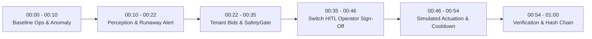

# ThermoPilot Compute Desk: 60-Second Demonstration Script

> **Flip the Switch Hackathon 2026** — Official presentation script, second-by-second timeline, operator cues, screen states, and fallback contingency runbook.

---

## 1. Executive Summary & Simulation Disclosure

> [!IMPORTANT]
> **SIMULATION BOUNDARY DISCLOSURE:**
> ThermoPilot Compute Desk operates strictly within a discrete-time simulation environment. All telemetry, core temperatures, junction hotspot calculations, and workload actuations are simulated mathematical models (Euler forward integration, Newton cooling $\tau=15.0\text{s}$, $R_{th}=0.14^\circ\text{C}/\text{W}$).
> **No physical GPUs, NVML drivers, DCGM interfaces, host power rails, or cloud infrastructure are touched or altered.**
> The demonstration does not claim real-world energy savings or physical hardware performance.

---

## 2. Second-by-Second Narration & Action Timeline (60 Seconds)

---

### [00:00 – 00:10] Act I: Baseline Operations & Anomaly Trigger

- **Screen / Terminal State:**
  - Launch command: `python -m thermopilot.cli --auto` (or Web Dashboard at `http://localhost:8080`).
  - Terminal displays:
    - Incident: `INC-20261027-001` | Status: `[DETECTED]` | Simulated Tag: `[SIMULATED ENVIRONMENT]`
    - Node Power: `380.0W / 400.0W (95%)`
    - Core Temp: `81.5°C [ABOVE SAFETY CEILING]`
    - Ambient Intake: `32.0°C [ANOMALY ACTIVE: +10°C INTAKE SURGE]`
    - Workload Alpha (`wl-alpha-inference`): VIP P0 Financial Trading Batch (230W, 90s SLA deadline, non-preemptible).
    - Workload Beta (`wl-beta-training`): Elastic P2 Diffusion Fine-Tuning (150W, elastic deadline).
- **Operator Interaction:**
  - Operator launches Compute Desk or resets demo: `python -m thermopilot.cli --auto`.
- **Narrator (Spoken, 10s):**
  > *"Welcome to ThermoPilot Compute Desk. Here in our operations control room, Node 0 is running dense cluster workloads: a mission-critical financial trading batch alongside an exploratory training job. Suddenly, a rack cooling fan failure injects a +10°C intake air surge."*

---

### [00:10 – 00:22] Act II: Predictive Perception & Runaway Intercept

- **Screen / Terminal State:**
  - Status transitions to `[FORECASTED]`.
  - Perception Panel:
    - Time-to-Trip ($t_{TTT}$): `23.3s to 85.0°C Trip Limit`
    - Thermal Trend: `RISING (+0.15°C/s, acceleration +0.002°C/s²)`
    - Risk Tier: `CRITICAL_RISK`
    - Safety Ceilings: Target `75.0°C`, Ceiling `80.0°C`, Critical Hardware Trip `85.0°C`.
- **Operator Interaction:**
  - None required; perception runs autonomously.
- **Narrator (Spoken, 12s):**
  > *"Rather than waiting for hardware to trigger an unmanaged shutdown at 85°C, our Perception Agent intercepts the curve at 81.5°C—giving operators a critical 23-second window before disaster strikes."*

---

### [00:22 – 00:35] Act III: Workload Negotiation & SafetyGate Certification

- **Screen / Terminal State:**
  - Status transitions to `[PLANNING]`.
  - **Workload Agent Bids:**
    - Agent Alpha (P0 VIP): Urgency `0.99`. Bids `POWER_CAP -> 220W` (*"VIP contract requires min 200W floor, non-preemptible"*).
    - Agent Beta (P2 Elastic): Urgency `0.10`. Bids `POWER_CAP -> 160W` (*"Can pause or shed for cluster credits"*).
    - Agent Gamma (P1 Analytics): Urgency `0.52`. Bids `POWER_CAP -> 80W`.
  - **Candidate Plans Table:**
    - `PLAN-A`: Conservative Workload Shed (Pause Beta, Alpha 220W) -> `[PASS - CERTIFIED]`
    - `PLAN-B`: Dynamic Power-Cap Balancing (Alpha 220W, Beta 160W) -> `[PASS - RECOMMENDED]`
    - `PLAN-C`: Workload Migration (Alpha 250W, Beta Migrate) -> `[PASS - CERTIFIED]`
    - `PLAN-D`: Blind 50% Throttle (Alpha 125W, Beta 125W) -> `[BLOCKED BY GATE]`
      - *Violations:* Rule 3 (P0 SLA Breach), Rule 5 (Alpha 125W < 200W Floor).
- **Operator Interaction:**
  - Observe candidate trade-offs; notice Plan D is visibly red and blocked.
- **Narrator (Spoken, 13s):**
  > *"Our workload-owner agents advocate for their business SLAs. The planner formulates recovery options, and our deterministic SafetyGate immediately blocks naive candidate Plan D because it breaches our VIP contract floor. Only mathematically certified plans reach the operator."*

---

### [00:35 – 00:46] Act IV: Switch HITL Operator Sign-Off

- **Screen / Terminal State:**
  - Status transitions to `[AWAITING_APPROVAL]`.
  - Decision Card Dispatched:
    - Executable Plans: `PLAN-A, PLAN-B, PLAN-C`
    - Blocked Plans: `PLAN-D (Execution button disabled)`
    - Timeout: `15.0s (Strict Policy: Timeout NEVER mutates workloads automatically)`
- **Operator Interaction:**
  - In interactive mode: Operator presses `[1]` or clicks **[Approve PLAN-A: Conservative Workload Shed]** (or Plan B).
  - *(Optional Test)*: Operator attempts `[4]` -> Console prints `[DENIED] Plan D is rejected by SafetyGate! State remains AWAITING_APPROVAL.`
- **Narrator (Spoken, 11s):**
  > *"Through Switch, the operator sees certified trade-offs. Notice our fail-safe policy: an unattended timeout never changes workloads without human sign-off. The operator approves Plan A."*

---

### [00:46 – 00:54] Act V: Pre-Execution Revalidation & Physical Cooldown

- **Screen / Terminal State:**
  - Status transitions: `[APPROVED] -> [EXECUTING] -> [VERIFYING]`.
  - Simulator Actuation:
    - Actions: `wl-alpha-inference: POWER_CAP (220.0W)`, `wl-beta-training: PAUSE (0.0W)`
    - Effective Node Power clamps: `380.0W -> 220.0W` (55% of 400W budget).
  - Telemetry Trajectory:
    - Core Temp decays smoothly: `81.5°C -> 74.2°C -> 63.0°C` (crosses 75.0°C recovery target in 3 ticks / 7.5 simulated seconds).
- **Operator Interaction:**
  - Watch live telemetry decay smoothly into nominal green.
- **Narrator (Spoken, 8s):**
  > *"The executor revalidates safety and applies the caps to the simulator. Power drops to 220W, and Newton cooling drives core temperature from 81.5°C down to 63°C in 7.5 simulated seconds."*

---

### [00:54 – 01:00] Act VI: Post-Execution Verification & Cryptographic Audit

- **Screen / Terminal State:**
  - Status transitions to `[RECOVERED]`.
  - **Verification Agent Report:**
    - Verdict: `[RECOVERY SUCCESSFUL - 75°C TARGET ACHIEVED]`
    - Trajectory: `81.5°C -> 63.0°C (Delta: -18.5°C)`
    - Cooling Rate: `1.05°C/s simulated (Target >= 0.50°C/s)`
    - Target Check: `75.0°C Envelope REACHED in 3 ticks (7.5s)`
    - VIP SLA Guard: `PASS (0 Breaches)`
  - **Cryptographic Audit Ledger:**
    - Badge: `[CHAIN VERIFIED: SHA-256 HASH INTEGRITY INTACT (19 EVENTS)]`
    - Chronological JSONL entries chained via cryptographic `prev_hash`.
- **Operator Interaction:**
  - None required; final screen displays verified business recovery.
- **Narrator (Spoken, 6s):**
  > *"Our Verification Agent confirms the 75°C target is restored with zero SLA violations, and our append-only SHA-256 audit ledger guarantees complete cryptographic accountability. ThermoPilot Compute Desk: autonomous governance with human control."*

---

## 3. Live Demonstration Commands & Quick Reference

| Action | Command Line | Expected Outcome |
| :--- | :--- | :--- |
| **Full Automated 60s Demo** | `python -m thermopilot.cli --auto` | Runs complete 8-stage sequence with full formatting. |
| **Interactive Operator Desk** | `python -m thermopilot.cli --interactive` | Operator hotkeys `[1]`, `[2]`, `[3]`, `[R]`, `[T]`. |
| **Web Control Room Dashboard** | `python -m thermopilot.cli --web --port 8080` | Launches local browser GUI at `http://localhost:8080`. |
| **SafetyGate Block Proof** | `python -m thermopilot.cli --attempt-plan-d` | Proves Plan D cannot be approved or executed. |
| **Operator Rejection Scenario** | `python -m thermopilot.cli --reject` | Proves rejection leaves simulator unchanged. |
| **Operator Timeout Scenario** | `python -m thermopilot.cli --timeout` | Proves timeout escalates without mutating workloads. |
| **Reset Simulator State** | `python -m thermopilot.cli --reset` | Cleans audit log and restores 81.5°C initial conditions. |

---

## 4. Resilience & Fallback Procedures

If any external subsystem or optional component is unavailable during presentation:

### Contingency 1: External Switch Webhook Unreachable
- **Behavior:** The system automatically falls back to `MockConsoleSwitchClient` and the local terminal/web interface.
- **Action:** No intervention needed; all approval workflows, decision card formatting, and audit logging execute locally.

### Contingency 2: Optional Remote Llama LLM Unavailable
- **Behavior:** `RecoveryPlanner` immediately falls back to `DeterministicFallbackPlanner`.
- **Action:** Plans A, B, C, and D are generated algorithmically in under 1 millisecond. No API token or network connection is required.

### Contingency 3: Network Drop or Disconnected Laptop
- **Behavior:** ThermoPilot is completely self-contained. Both the CLI and Web Dashboard run entirely on `127.0.0.1` using Python's standard library.
- **Action:** Disconnect Wi-Fi if needed; the demo runs 100% offline.

---

## 5. Architectural Proof Points for Hackathon Judges

1. **Multi-Agent Negotiation:**
   Autonomous workload-owner agents (Alpha P0, Beta P2, Gamma P1) calculate deterministic urgency scores based on contractual SLA deadlines and submit structured mitigation proposals.
2. **Deterministic Safety Gate:**
   Mathematical invariants are hardcoded and non-bypassable. Plan D is permanently blocked from reaching execution, regardless of LLM recommendations or operator prompts.
3. **Fail-Safe HITL Governance:**
   Operator timeout NEVER defaults to changing workloads. If an operator is unreachable, the system alarms and escalates without modifying compute allocations.
4. **Append-Only Cryptographic Audit Ledger:**
   Every event across perception, bidding, planning, approval, actuation, and verification is hashed and bound to the preceding hash using SHA-256. Tamper-evident verification runs live on every screen.
5. **Honest Verification:**
   The Verification Agent measures actual physical telemetry from forward Euler integration and Newton cooling. It never fabricates measurements or forces artificial success.
